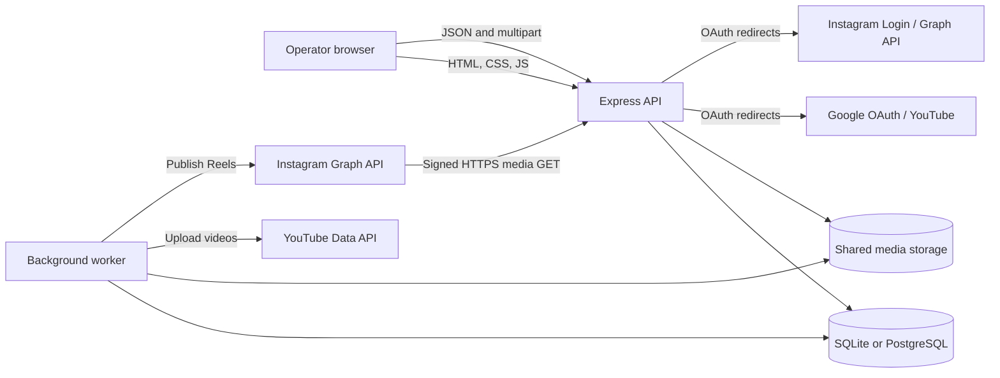

# High-Level Design

## 1. Purpose and scope

Video Scheduler is a self-hosted application for scheduling and publishing video content to YouTube and Instagram Reels. It supports individual/batch uploads, a persistent queue, channel/account management, folder-based recurring rotation, upload history, and an operator dashboard.

This document captures the current product and architecture. It does not describe the unrelated analytics product proposed in a former document or the unimplemented React/Fastify design previously present in `docs/`.

## 2. System context

## 3. Runtime units

| Unit | Entry point | Responsibility |
|---|---|---|
| Web/API server | `src/server.js` | Serves static pages, handles auth, upload intake, job and account APIs, folder/rule APIs, health, and database explorer. |
| Worker | `src/worker.js` | Runs queue scheduling and provider publishing; starts folder watchers; runs recurring rotation planning and media cleanup. |
| Database | `src/db.js` | Initializes schema/migrations and adapts the async query interface to SQLite or PostgreSQL. |
| Browser UI | `public/index.html`, `public/login.html` | Operator dashboard and sign-in/registration pages. |
| Media storage | `STORAGE_ROOT` (default `./storage`) | Stores uploaded media and canonical copies staged by rotation. Shared by API and worker. |

In Docker Compose, API and worker containers share PostgreSQL and the `storage` volume. Local default configuration uses SQLite and a local storage directory.

## 4. Main workflows

### 4.1 Manual scheduling and publishing

1. The operator selects one or more video files and supplies shared and/or per-file metadata in the browser.
2. `POST /api/videos` validates and stages files on disk, then inserts one `pending` job per file.
3. The worker scans for due pending jobs, checks channel/account availability and limits, then claims a job atomically.
4. The provider adapter uploads/publishes the file.
5. Success writes provider upload metadata and marks the job `done`; failures are classified and either marked `failed`/`exhausted` or requeued with backoff.
6. The browser reads job state from `GET /api/videos` and renders queue/history.

### 4.2 Folder rotation

1. The operator registers an absolute folder path; the scanner indexes supported files and hashes them with SHA-256.
2. A rotation rule binds a folder to a YouTube channel, frequency, local wall-clock time, IANA timezone, start date, pool mode, and caption template.
3. Chokidar change events schedule debounced scans. A periodic scan catches changes missed while the process was down or a watcher was unavailable.
4. The worker planner calculates the next available slot per active rule. Slots are DST-aware and limited to eight lookahead candidates per planning pass.
5. It creates a planned assignment. For slots within 72 hours it copies or reuses media in `STORAGE_ROOT`, creates a normal pending YouTube job, and links the assignment to that job.
6. Normal worker publishing executes the job. Orphaned canonical media is removed by the worker cleanup pass when no job references it.

### 4.3 Instagram Reel publishing

1. The operator connects an Instagram account through Instagram Login.
2. The account's long-lived token and expiry are stored.
3. A Reel job requires an active Instagram account, MP4/MOV file, and public HTTPS `APP_PUBLIC_URL`.
4. The worker creates a signed URL, asks Instagram to fetch the video, polls container processing status, then publishes it.
5. Instagram media ID/permalink are stored in `instagram_uploads`.

## 5. Data stores and ownership

- **Relational database:** users, YouTube channels, Instagram accounts, jobs, uploads, folders, source items, rotation rules/assignments, and media asset metadata.
- **Filesystem:** staged uploaded videos and rotation-managed copies. Database job filenames are relative names under `STORAGE_ROOT`.
- **Browser local storage:** selected light/dark theme only; it is not authoritative application data.

There is no Redis, message broker, external frontend build output, or tenant ownership mapping in the current implementation.

## 6. Quality attributes

- **Durability:** queue and rotation state live in the database; media files live on a persistent volume and need backups coordinated with the database.
- **Responsiveness:** uploads run in the worker process, separate from HTTP request handling.
- **Concurrency:** global and per-channel limits are configurable. Database conditional job claims reduce duplicate work across workers.
- **Quota awareness:** YouTube dispatch checks estimated upload costs against per-channel budgets and configured safety fraction; transient/rate errors receive exponential backoff.
- **Portability:** a common async data interface supports SQLite and PostgreSQL; time-slot generation uses built-in `Intl` timezone support.
- **Security:** HTTP-only session cookies, OAuth CSRF state, signed expiring media URLs, route-level auth, and bounded read-only explorer queries. Stored OAuth tokens are not encrypted at application level.

## 7. Deployment and configuration

`npm run dev` starts the API and `npm run dev:worker` starts the worker separately. `docker-compose.yml` defines API, worker, PostgreSQL, shared media storage, and a mounted Google credentials secret. Relevant settings are documented in the root README and loaded in `src/config.js`.

Important configuration groups include:

- Server: `PORT`, `NODE_ENV`
- Database: `DB_DRIVER`, `DB_PATH`, `DATABASE_URL`
- Storage: `STORAGE_ROOT`
- Auth: `REQUIRE_AUTH`, `JWT_SECRET`, `JWT_EXPIRES_IN`, `LOGIN_EMAIL`, `LOGIN_PASSWORD`, cookie settings
- Google: YouTube OAuth credentials, scopes, and callback URLs
- Instagram: app ID/secret, callback URL, and public HTTPS app URL
- Worker: tick cadence, global/per-account concurrency, planner cadence
- Quota/retries: daily quota, estimated upload cost, safety factor, retry bounds
- Uploads: maximum files per request and maximum file size

## 8. Observability

`GET /api/health` returns status, time, dry-run mode, database driver, channel count, and process uptime. Server and worker emit logs for queue dispatch, upload results, retries, rotation planning, scans, and cleanup. There is no metrics backend or structured centralized logging configured in the repository.

## 9. Boundaries and known limitations

- The app is currently a single-operator/admin-oriented product; users do not own or scope jobs and accounts through foreign keys.
- Media lifecycle for manually uploaded files is not automatically equivalent to rotation-managed media cleanup.
- Folder scanning is non-recursive and accepts a fixed set of video extensions.
- YouTube quota estimates are configured estimates; provider quota policy and actual request costs can differ.
- Instagram publishing requires a provider-enabled account and public HTTPS access to the signed media endpoint.
- The app's security posture requires production secrets, TLS, deployment credentials, database backups, and filesystem backups to be managed by the operator.
